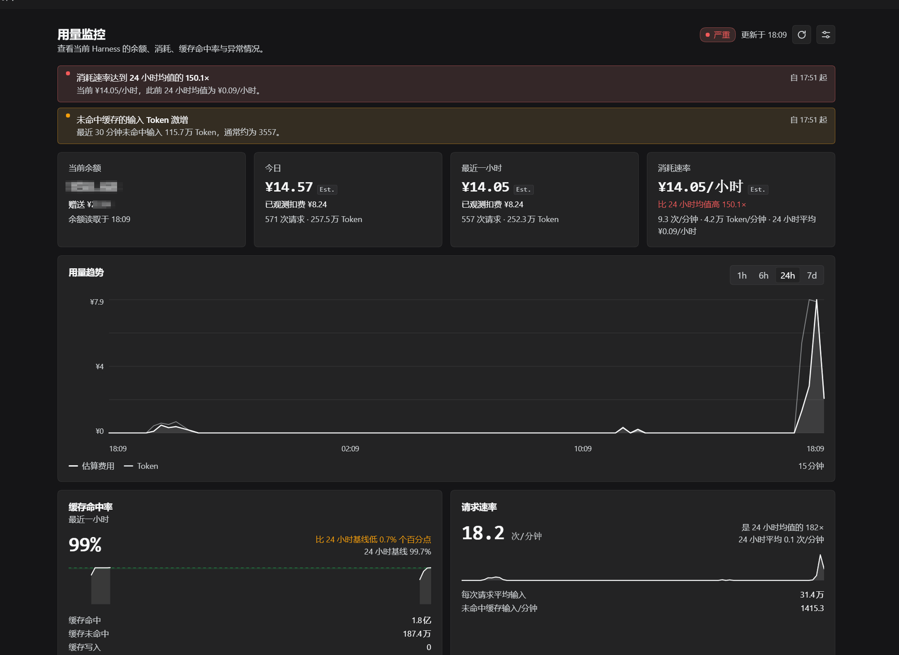
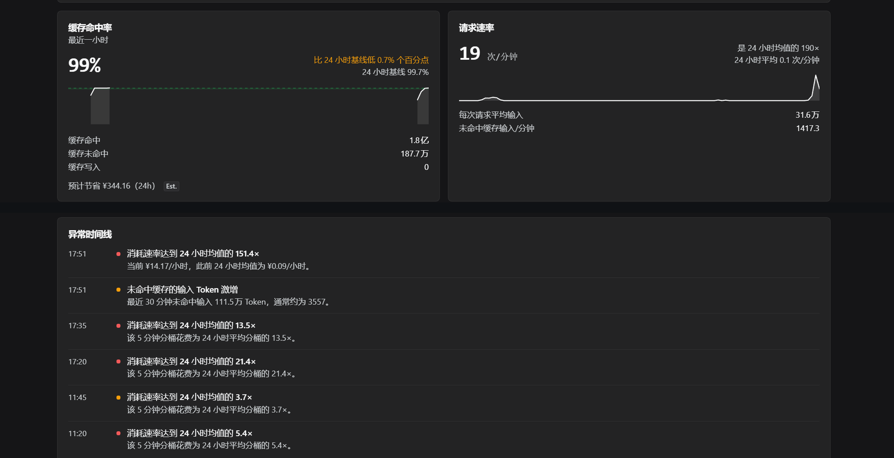

# DeepSeek Harness Usage Monitor

**Real-time balance, token usage, cache hit rate and abnormal spend detection inside DeepSeek Harness.**

A DeepSeek Harness (DSH) plugin that adds a **Usage Monitor** panel to the Harness sidebar: the
real signed-in wallet balance, provider-reported token usage, cache hit rate, burn rate,
cost attribution, cache diagnostics, anomaly detection and a balance forecast — all computed
locally from official Harness data.

[](https://github.com/Freeman945/deepseek-harness-usage-monitor/actions/workflows/ci.yml)
[](LICENSE)
[](package.json)

English | [简体中文](README.zh.md)

---

## Screenshots





Both images are real captures from a local DeepSeek Harness run with the plugin installed (dark
theme, Chinese UI; the UI is fully localized in English and Chinese). Wallet amounts are redacted;
no mock or demo data is shown. The second image stacks two regions of the same dashboard:
cache/request cards and the anomaly timeline.

---

## Features

| Feature | What it does |
|---|---|
| **Real balance monitoring** | Reads the signed-in DeepSeek account wallet through Harness's official account service. Recharge and bonus wallets are shown separately. No currency conversion, no invented balance. |
| **Token usage** | Provider-reported input, output, cache-read and cache-write tokens from durable Session logs, refreshed live while a Session runs. |
| **Burn rate** | Estimated spend per hour over the last 5 min / 30 min / 1 hour, compared with the previous 23-hour baseline. |
| **Cost windows** | Today, last hour, last 24 hours, last 7 days and this month — each with an `Est.` (tokens × price table) and, where coverage exists, an `Observed` (real wallet decrease) number. |
| **Cache monitoring** | Cache hit rate with the same formula Harness uses, delta vs the preceding 24-hour window, estimated savings from cache hits, and a per-bucket trend. |
| **Agent / session / model usage** | Top consumers by session, by task (conversation turn), by agent preset / subagent, by uncached token cost, plus a per-model breakdown. |
| **Anomaly detection** | Deterministic rules for burn-rate spikes, low cache hit rate, uncached-input bursts, cost spikes, cache-problem correlation, request spikes, low balance — with a 24-hour timeline and "returned to normal" entries. |
| **Alerts** | The same conditions surface as alerts with the time they started; balance-threshold alerts are configurable. |
| **Trends** | Usage charts for 1 h, 6 h, 24 h and 7 d with automatic bucket sizes. |
| **Forecast** | Estimated daily cost and estimated remaining balance time at the current burn rate, with the basis stated. |
| **Light / dark, English / Chinese** | Uses Harness theme tokens and the active Harness locale. |
| **Local only** | No telemetry, no upload, no third-party service, no runtime dependencies. |

> Harness already shows the current turn's usage in the chat view and the account balance under
> Settings → Account. This plugin turns that same official data into a persistent dashboard, adds
> historical windows and attribution, and explains *why* spend moved.

## Requirements

| Requirement | Detail |
|---|---|
| DeepSeek Harness | **0.2.1-rc.2** (desktop or web profile) |
| Plugin version | **0.1.0** |
| Node.js | **≥ 20** (DSH bundles its own Node; this matters only for development) |
| DeepSeek account | Signed in under **Settings → Account** for the real balance. Token and estimated-cost panels work without it. |
| API key | **Not needed.** The plugin never asks for, reads or stores one. |
| Environment variables | **None.** There is no `.env` to create. |
| Build step / dependencies | **None.** Plain Node.js ESM; zero runtime dependencies. |

## Installation

### Step by step

1. **Clone the repository** to a permanent location. The bundle is installed by folder path, so do
   not move or delete the folder afterwards.

   ```bash
   git clone https://github.com/Freeman945/deepseek-harness-usage-monitor.git
   ```

2. **Open the Harness Web GUI** and go to **Sidebar → Plugins**.

3. **Add the plugin:** choose **Add plugin**, paste the **absolute path** to the cloned folder,
   and confirm.

   ```text
   Windows:  C:\Users\<you>\deepseek-harness-usage-monitor
   macOS:    /Users/<you>/deepseek-harness-usage-monitor
   Linux:    /home/<you>/deepseek-harness-usage-monitor
   ```

4. Click **Install**, then **Enable now** (or enable *Usage Monitor* from the Plugins list).

5. Open **Usage** (用量) in the sidebar panel list — the **Usage Monitor** (用量监控) page opens in
   the main panel. If the entry is not visible yet, reload the Harness window once.

No API key and no configuration are required. If you are signed in to a DeepSeek account, the
balance appears on the next poll; token history is read from existing Session logs immediately.

### Alternative: let the Harness agent install it

Ask the Harness agent to install the bundle with the `plugin_manager` tool — `action:
install_bundle`, `target: <absolute path to the folder>`. Wait for the *enabled* confirmation, then
reload the window if the panel is not visible.

### Alternative: CLI

```bash
dsh plugin --profile <profile-name> add link:<absolute-path-to-folder>
```

Then enable the bundle in the Plugins page, or add `deepseek-harness-usage-monitor` to
`dsh.profile.bundles` in `$DSH_HOME/profiles/<profile-name>/package.json` and restart Harness.

### Uninstall / reset

Disable or remove the bundle in the Plugins page. Runtime data is stored outside the package in
`$DSH_HOME/usage-monitor/` (default `~/.dsh/usage-monitor/`); delete that folder to reset history,
settings and observed-spend coverage.

## Usage

Open the **Usage** entry in the left sidebar panel rail — the **Usage Monitor** page opens in the
main panel. It refreshes every 5 seconds while the page is visible; the wallet is polled no more
often than `balanceRefreshSeconds` (default 45 seconds, configurable 20–600).

| Number | Meaning | Honest caveat |
|---|---|---|
| **Balance** | The real wallet amount from your DeepSeek account, recharge and bonus wallets shown separately. | Requires being signed in. Never converted between CNY and USD. |
| **Burn rate** | Estimated spend per hour for the last 5 min / 30 min / 1 hour, and its ratio to the previous 23-hour average. | Estimated: tokens × official price table. |
| **Cache hit rate** | `cacheRead / (cacheRead + input + cacheWrite)` for the last hour, plus the change vs the preceding 24-hour window. | Same formula as Harness's own usage display. |
| **`Est.` amounts** | Tokens × the official DeepSeek price table, peak/off-peak aware. | An estimate, **not** a provider invoice. |
| **`Observed` amounts** | Real money: the decrease of your wallet between balance polls, summed over the window. | Starts when monitoring starts; no historical backfill. Marked incomplete until the window is fully covered. |
| **Top consumers** | Sessions, tasks (turns), agent presets and uncached-token cost rankings. | Attribution comes from Session metadata, not a per-request agent name. |
| **Why is usage high?** | Cache diagnostics and anomaly evidence for the current window. | It reports correlated evidence, never a proven provider-side root cause. |
| **Forecast** | Estimated daily cost and estimated remaining balance time at the recent burn rate. | A projection from recent usage, not a guarantee. |

Use the **range switch** (1 h / 6 h / 24 h / 7 d) to change the trend chart, and the **gear** to
open Settings. **Refresh** forces one wallet read and one Session rescan without waiting for the
timers. The **timeline** lists anomalies newest-first, including "Usage returned to normal"
entries.

## Configuration

There is **no environment variable, no `.env` file and no API key** to create. The thresholds and
intervals you normally tune live in the dashboard's **Settings** drawer; they are validated,
clamped, persisted in `$DSH_HOME/usage-monitor/settings.json`, and take precedence over bundle
defaults. A few advanced fields are accepted by the Host but have no drawer control in v0.1.0 and
are set through the bundle row or the settings API (see below).

### In the Settings drawer

| Setting | Default | Range / notes |
|---|---|---|
| `currency` | `auto` | `auto` follows the signed-in wallet; `CNY` / `USD` force the price table. No conversion. |
| `balanceRefreshSeconds` | `45` | 20–600. Minimum interval between wallet reads. |
| `warningBurnRatio` | `2` | Burn rate ≥ this multiple of the 23-hour baseline → warning. |
| `criticalBurnRatio` | `4.5` | Burn rate ≥ this multiple → critical. Raised to the warning value if set lower. |
| `cacheWarningRate` | `0.5` | Cache hit rate below this → warning (must hold for `cacheAlertMinutes`). |
| `cacheCriticalRate` | `0.3` | Cache hit rate below this → critical. Lowered to the warning value if set higher. |
| `cacheAlertMinutes` | `10` | 1–240. Sustained minutes before a low-cache alert fires. |
| `requestRateWarningMultiplier` | `2` | Reserved multiplier for request-rate conditions. |
| `costSpike10m` | `5` | Display-currency amount spent in 10 minutes that counts as a spike. |
| `balanceAlerts` | `[50, 20, 10]` | Display-currency thresholds; the first breached one fires, the lowest breached one is critical. |
| `retentionDays` | `14` | 1–30. Request rows and wallet samples older than this are pruned. |

### Advanced settings (bundle row or settings API)

These fields are validated by the same allow-list but are not in the drawer yet. Set them in the
bundle row `config` (they seed defaults until a `settings.json` exists — delete that file to re-seed)
or POST them to `/api/usage-monitor/settings` from the signed-in Harness page.

| Setting | Default | Notes |
|---|---|---|
| `scanIntervalSeconds` | `60` | 15–600. Full Session rescan interval (live events are still incremental). |
| `holidays` | `[]` | `YYYY-MM-DD` Chinese public holiday dates; they switch estimates to off-peak pricing. |
| `pricingOverrides` | `{}` | Per-model or per-tier `{cacheHit, cacheMiss, output}` prices per 1M tokens, in the display currency. |
| `exposeDiagnosticsFile` | `true` | Writes `$DSH_HOME/usage-monitor/status.json` (no prompts, no credentials) for support. Set `false` to disable. |

### Bundle-row defaults

The bundle inserts one Host row (`cordis.patch.yml`). Its `config` seeds defaults only until you
save settings in the page; after that the saved settings win.

```yaml
- insert:
    - id: usage-monitor
      name: deepseek-harness-usage-monitor
      config:
        balanceRefreshSeconds: 45   # wallet poll floor, seconds
        retentionDays: 14           # request/wallet sample retention
```

> If you need a configured holiday list on a machine that already saved settings, POST it to the
> settings API or delete `$DSH_HOME/usage-monitor/settings.json` and reinstall the row config.

## How anomaly detection works

The plugin does **not** use machine learning, EWMA or an opaque score. Every condition is a
deterministic rule over the retained samples; each has a stable ID so the timeline can remember
when it started and when it recovered. The thresholds are configurable in the Settings drawer.

**Windows and baseline.** Request samples are bucketed per minute. The baseline is the previous
23 hours, excluding the current hour. Baselines are plain arithmetic means over fixed windows —
there is no median smoothing, no EWMA and no learned weights:

```text
burn(window).costPerHour  = estimated cost in window / window hours
baseline24h.costPerHour   = estimated cost in [now − 24h, now − 1h] / 23
burnRatio                 = burn(last1h).costPerHour / baseline24h.costPerHour
```

| Condition | Exact rule (defaults) | Level |
|---|---|---|
| `burn-rate` | `burnRatio ≥ warningBurnRatio` (2) → warning; `≥ criticalBurnRatio` (4.5) → critical | warning / critical |
| `cache-low` | last-hour hit rate `< cacheWarningRate` (0.5) continuously for `cacheAlertMinutes` (10) → warning; `< cacheCriticalRate` (0.3) → critical | warning / critical |
| `cost-spike` | estimated cost of the last 10 minutes `> costSpike10m` (5 display-currency units) | warning |
| `uncached-burst` | uncached input tokens in the last 30 min `> 3 ×` the 23-hour average per 30 min **and** `> 10,000` tokens | warning |
| `cache-problem-correlated` | `burnRatio ≥ 1.5` **and** last-hour hit rate fell `≥ 0.15` below the previous 24-hour rate | critical |
| `balance-low` | wallet below a configured threshold (default 50 / 20 / 10); the lowest breached threshold is critical | warning / critical |
| `recovered` | a previously active condition has been inactive for ≥ 2 minutes | info |

**Historical ledger.** The timeline also reconstructs 24 hours of 5-minute buckets from the stored
request rows:

- `burn-rate` — a bucket whose cost is ≥ `warningBurnRatio` / `criticalBurnRatio` times the 24-hour
  average cost per 5-minute bucket;
- `cache-hit-drop` — a bucket with ≥ 5 requests whose hit rate is more than 0.20 below the 24-hour
  average;
- `request-spike` — a bucket with more than 4× the average request count and at least 8 requests.

Consecutive buckets of the same type are merged, and the newest 20 historical entries are shown.

**What it is not:** there is no seasonal adjustment, no holiday awareness for usage (only for
pricing), no absolute-token alarm, and every monetary rule is computed on the *estimated* cost,
not on the wallet. The wallet is used only by `balance-low` and by observed spend.

## Cache diagnostics

Cache hit rate is computed as:

```text
hitRate = cacheReadTokens / (cacheReadTokens + inputTokens + cacheWriteTokens)
```

The plugin inspects the Session events that Harness already records and reports only causes it can
back with recorded evidence (in the "Why is usage high?" panel):

| Check | Evidence it records | What it suggests |
|---|---|---|
| **Request-epoch change** | `request/header` events whose reason is `change`; count + timing | Tools, system prompt or model changed, so the cacheable prefix was rebuilt |
| **System-prompt hash change** | Distinct truncated SHA-256 hashes of system-message text in one Session | The prefix could not stay stable |
| **Toolset change** | Distinct tool-list sizes seen in request headers | Adding/removing tools invalidates the prefix after the change |
| **Model switch** | Distinct model ids in one Session | Provider caches are per model; the first request always misses |
| **Compaction break** | Count of `compaction/start` events | Compaction rewrites history; the first request after it cannot reuse the old prefix |
| **TTL gap** | Gaps > 30 min between usage samples, and the hit rate of the first samples after each gap | Provider cache likely expired during inactivity |
| **Timestamp / UUID in prefix** | Regex counts of ISO-like timestamps and UUIDs inside system-message text (counts only, never the text) | A per-request timestamp/UUID makes every prefix different |
| **Cache not reported** | Sessions where more samples report zero cache counters than reported ones | The model/provider may not support prefix caching |
| **Context growth** | Average prompt size in the last hour > 1.8× the previous 24-hour average | Context growth does not break the prefix, but it makes every miss more expensive |
| **Hit-rate drop / correlation** | Last-hour hit rate vs previous 24 hours; combined with burn ratio | Misses are a likely cost driver |

Causes are only evaluated for sessions with at least 5,000 uncached input tokens in the last hour
and a hit rate below the global 24-hour rate.

**What it cannot prove:** the plugin cannot see the provider's cache keys or hit/miss reasons.
A recorded header change may be caused by a Harness configuration change rather than by a bug;
a timestamp in the system prompt may be intentional; a TTL gap is inferred from request timing,
not reported by the provider. These are labeled as *possible* causes, not findings. The system
prompt itself is never stored — only a truncated hash and counts.

## Data & privacy

Everything is local. The full inventory is in [`docs/DATA-SOURCES.md`](docs/DATA-SOURCES.md) and
the policy is in [`SECURITY.md`](SECURITY.md).

| Question | Answer |
|---|---|
| Where is the data? | `$DSH_HOME/usage-monitor/` (default `~/.dsh/usage-monitor/`): `state.json`, `settings.json`, and `status.json` (support snapshot, written by default). It is gitignored and never inside the package or the profile. |
| What is stored? | Aggregated token counters, wallet samples, Session titles/cwd/preset metadata, cache signal counts and anomaly-condition timestamps. **No prompt text, no completion text, no credentials.** |
| What leaves the machine? | Nothing except the official balance read performed by Harness's own `deepseekAccount` service against your signed-in DeepSeek account. The plugin makes no network request of its own, sends no telemetry and uploads nothing. |
| Does it read my API key or cookies? | No. The plugin never reads credentials; Harness's account service owns them and returns only parsed wallet amounts. |
| Are my prompts stored? | No. For cache diagnostics, a system message is reduced to a truncated SHA-256 hash plus UUID/timestamp counts. |
| How long is data kept? | `retentionDays`, default **14 days**, configurable 1–30; pruned every 10 minutes. Wallet history is downsampled after 720 samples. |
| What is `status.json`? | A small support snapshot without prompts or credentials; it is written by default and can be disabled with `exposeDiagnosticsFile: false` (advanced settings). Review it before sharing. |
| How do I delete everything? | Remove the bundle, then delete `$DSH_HOME/usage-monitor/`. |

The plugin is read-only with respect to Harness: it never appends to, rewrites or deletes Session
logs, and it registers only same-origin, authenticated dashboard routes.

## Development

Requirements: Node.js ≥ 20 and a DSH 0.2.1-rc.2 install for live testing. There is nothing to
install — no dependencies, no build step.

```bash
npm test                          # node --test test/*.test.js
npm run check                     # syntax, JSON, manifests, secrets, docs
node scripts/security-audit.mjs   # secrets/PII, working tree + Git history
npm run verify:live               # requires a live install: cross-checks the status file,
                                  # state.json and the raw Session logs / Harness projection cache
```

| Path | Responsibility |
|---|---|
| `index.js` | Host entry: `apply`, `inject`, route registration, index injection |
| `lib/monitor.js` | Engine: Session scanning, live events, wallet polling, HTTP, lifecycle |
| `lib/ingest.js` | Session-event folding: usage counters and cache signals |
| `lib/analytics.js` | Snapshot aggregation: windows, burn, cache, anomalies, consumers, forecast |
| `lib/pricing.js` | Official price table, peak/off-peak rule, cost estimates |
| `lib/store.js` | Settings validation, atomic local state, retention |
| `client.js` | Browser half: sidebar entry, dashboard, settings drawer, i18n |
| `locale/` | English and Simplified Chinese display strings |
| `test/` | Node test runner tests and synthetic fixtures |
| `docs/` | API contract, architecture, data sources, UI notes, roadmap, screenshots |

**Install a development copy:** follow [Installation](#installation) but point at your working
clone; changes to Host files take effect on plugin reload, and `client.js` changes on window
reload. Delete `$DSH_HOME/usage-monitor/` to reset state while testing.

**Screenshots:** only real captures from a local Harness run are committed — never mockups. Run
the plugin, open the dashboard, capture the window, redact wallet amounts/session titles/paths, and
save as `docs/screenshots/dashboard.png` and `docs/screenshots/cache-anomaly.png`.

More detail: [`docs/ARCHITECTURE.md`](docs/ARCHITECTURE.md),
[`docs/DATA-SOURCES.md`](docs/DATA-SOURCES.md), [`docs/API.md`](docs/API.md),
[`docs/UI.md`](docs/UI.md), [`CONTRIBUTING.md`](CONTRIBUTING.md).

## Known limitations

1. **Agent identity is derived, not recorded.** Session events do not contain a per-request agent
   name. Agent-preset and subagent attribution comes from Harness Session metadata (preset,
   subagent origin/parent session, cwd, session title).
2. **"Tasks" are conversation turns.** A task row means one turn of one Session, not a Harness
   job or background task.
3. **Observed spend has a start date.** It is measured from the plugin's first wallet poll; there
   is no historical balance backfill. Token history *is* read from existing Session logs.
4. **Peak/off-peak pricing does not know Chinese public holidays** unless you configure them as
   advanced settings (bundle row or settings API). Until then, holiday requests are estimated at the
   peak rate.
5. **Search / Fetch billing is not included.** Those calls are free until 2026-11-01 Beijing time
   and are not modeled by the plugin. Model token costs are the only costs estimated.
6. **API-key-only setups have no balance.** Without a signed-in DeepSeek account the wallet can't
   be read; token and estimated-cost panels still work.
7. **Estimates are not a bill.** There is no Harness-side cost calculator and no provider
   billing-history API; per-session/model amounts are token counts × the published price table.

## Roadmap

- More provider adapters for the pricing layer.
- Budget policies and notifications through Harness-native surfaces.
- Usage report export (CSV / JSON), local only.
- Deeper cache diagnostics (better root-cause evidence, still without storing prompts).
- Historical balance coverage research.

See [`docs/ROADMAP.md`](docs/ROADMAP.md) for detail and non-goals.

## Contributing

Issues and pull requests are welcome. Please read [`CONTRIBUTING.md`](CONTRIBUTING.md) and
[`SECURITY.md`](SECURITY.md) first. In short: no runtime dependencies, no secrets or private data,
every claim must match code and documented Harness behavior, and both English and Chinese UI
strings must be updated together.

## License

MIT — see [`LICENSE`](LICENSE). Copyright (c) 2026 Freeman945.

This plugin is built for **DeepSeek Harness**, which is also MIT-licensed
(Copyright (c) 2026 DeepSeek): <https://github.com/deepseek-ai/deepseek-harness>. DeepSeek and
DeepSeek Harness are trademarks of their respective owners; this project is an independent plugin
and is not affiliated with or endorsed by DeepSeek.
